# Agent-aware LLM routing and autoscaling on Kubernetes

**Bachelor thesis, Faculty of Computer Science and Engineering (FCSE), Skopje**
*Рутирање на LLM повици и автоматско скалирање на vLLM инстанци во Kubernetes околина*


> An LLM agent doesn't make one request. It makes a **chain** of them, and every call resends the whole conversation so far.
> Today's load balancers treat each of those calls as a stranger. This project teaches the cluster that the calls belong together.

---

## Contents

- [The problem in one picture](#the-problem-in-one-picture)
- [What this system does](#what-this-system-does)
- [Architecture](#architecture)
- [How a call is routed](#how-a-call-is-routed)
- [Autoscaling on remaining work](#autoscaling-on-remaining-work)
- [Scale-down and failure](#scale-down-and-failure)
- [The chat app on top](#the-chat-app-on-top)
- [The experiments, as designed](#the-experiments-as-designed)
- [Status](#status)
- [Results so far](#results-so-far)
- [Running it](#running-it)
- [Repository layout](#repository-layout)
- [What it was built and tested on](#what-it-was-built-and-tested-on)

---

## The problem in one picture

An agent task ("summarise this CSV and compare two regions") runs as a loop: the model picks a tool, the tool runs, the result is appended to the context, and the model is called again. Each call's prompt is the previous prompt **plus a little more**.

vLLM keeps the attention state (the **KV cache**) of prompts it has already processed. If the next call of the same task lands on the **same pod**, almost the entire prompt is a cache hit and only the new tail is computed. If it lands anywhere else, the whole prompt is processed again from scratch.

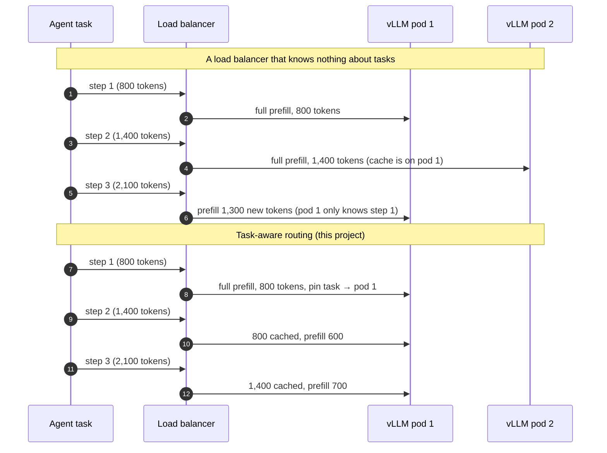

*Illustrative token counts.*

Two more things go wrong at scale:

| Problem | Why standard tools miss it |
|---|---|
| **Autoscaling reacts too late.** | CPU-based scaling sees nothing (the work is on the GPU). Queue-based scaling only reacts *after* requests pile up. But the moment 20 agent tasks start, the cluster already *knows* roughly how many calls are coming. |
| **Scale-down and crashes break tasks.** | A pod removed mid-task loses that task's cache and, without care, the in-flight call. A multi-step task is only useful if it finishes. |

---

## What this system does

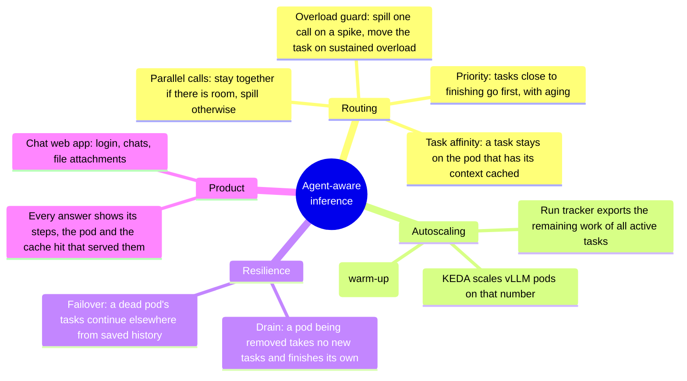

Every LLM call carries four headers so that the infrastructure can see the task it belongs to:

| Header | Meaning | Used by |
|---|---|---|
| `x-run-id` | Which task (run) this call belongs to | Affinity pin, end-of-run signal, logs |
| `x-step` | Which step of the run this is (1, 2, 3 …) | Priority, remaining work |
| `x-expected-steps` | How many steps this kind of task usually takes, learned from recorded runs | Priority, remaining work |
| `x-parallel-group` | Calls sent together in one model reply (e.g. reading three documents at once) | Parallel-call rule |

The headers, the trace format, the run request, the run events and the run calls are **versioned JSON schemas** in [`schemas/`](schemas/), and every component that reads or writes one runs contract tests against it.

---

## Architecture

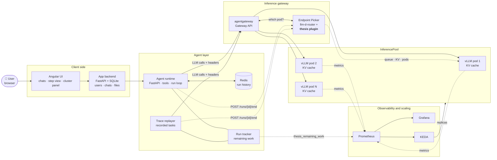

| Component | Folder | Role |
|---|---|---|
| **Endpoint Picker plugin** | `gateway/` | Go filter plugin for [llm-d-router](https://github.com/llm-d) (the Gateway API Inference Extension's Endpoint Picker). Holds the `run-id → pod` pins, the overload guard and the parallel-call rule. Each rule has a feature flag. |
| **Agent runtime** | `agent/` | Runs the tool loop. Tools are high-level and deterministic (Python computes, the model only orchestrates); tool arguments are enums wherever possible. LLM calls are non-streaming, so a retry after a pod failure is simple. |
| **Run tracker** | `agent/` (shared with `loadgen/`) | Keeps the state of active runs and exports their remaining work as a Prometheus metric. |
| **App backend** | `app/` | Users, sessions, chats, messages, attachments in SQLite. One chat message = one agent run. |
| **UI** | `ui/` | Angular app: login, chats, step view with pod and cache badges, cluster panel. |
| **Load generator** | `loadgen/` | Records real agent runs into traces, converts public agent traces (AgentProcessBench) into the same format, replays them with realistic gaps and arrival patterns. |
| **Simulator** | `sim/` | [llm-d-inference-sim](https://github.com/llm-d/llm-d-inference-sim) pods calibrated from the real GPU (prefill cost, per-token time, cold start), to run autoscaling at scales one GPU can't hold. |
| **Infra** | `infra/` | Idempotent scripts and Helm values: `make up` builds the whole cluster from zero. |
| **Config** | `config/` | Every tunable in one place, in profiles (`real`, `sim`, `demo`). Nothing is hardcoded. |

---

## How a call is routed

The plugin is a **filter**, not a scorer: a scorer can be outvoted by other scorers, a filter is a hard rule. On the first step of a run, the stock scorers (queue, KV usage, prefix match) pick the pod; from then on, the pin decides, unless the pinned pod is in trouble.

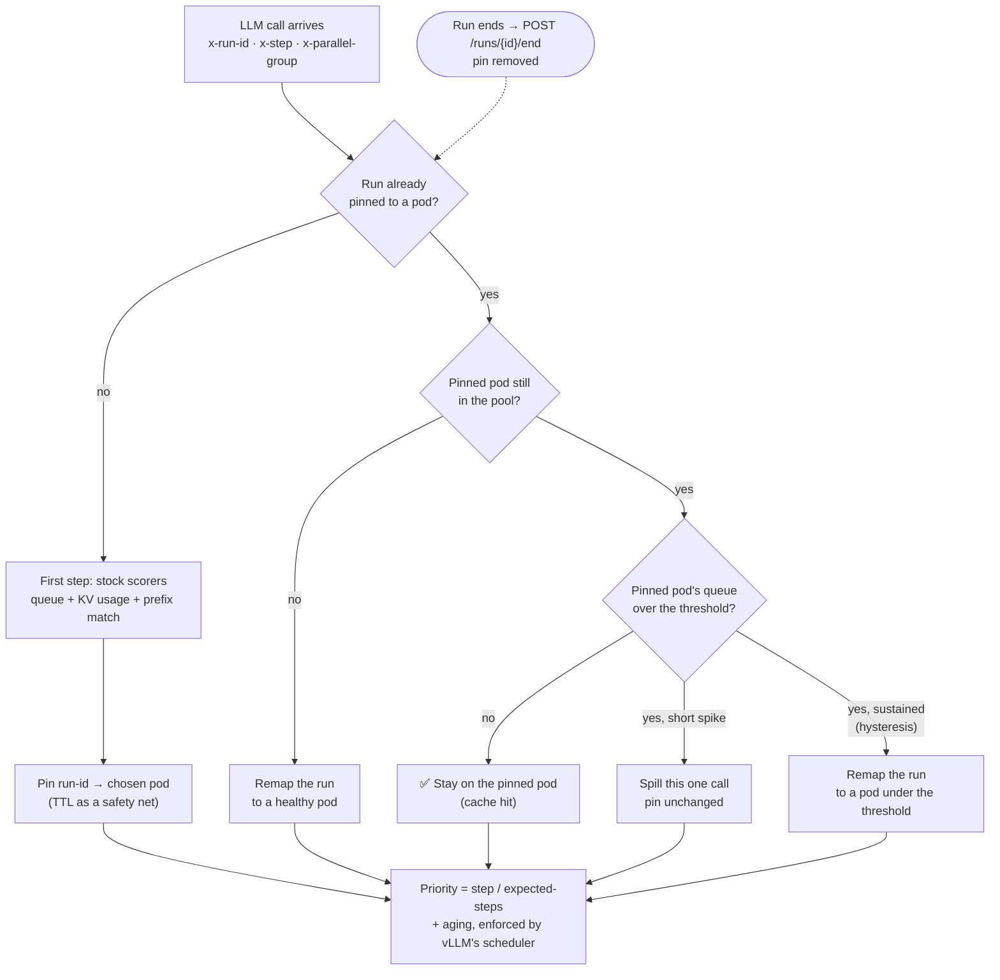

**Why each rule exists:**

| Rule | Without it | With it |
|---|---|---|
| **Task affinity** | A task's calls scatter, each move re-processes the whole prompt | Steps 2…n hit the cache on the same pod |
| **Overload guard** | A pinned task waits behind a long queue rather than move | A spike costs one spilled call; only sustained overload moves the task (and its cache) |
| **Parallel calls** | Calls fired together in one reply land wherever | They share the pod while it has room, spill only under overload |
| **Progress priority** | A task one step from done waits behind a brand-new one | Nearly finished tasks finish; aging guarantees nobody starves |
| **Warm-up routing** | A fresh pod idles while warm pods queue | New runs prefer the newest pod right after it becomes Ready |

---

## Autoscaling on remaining work

Each active run knows its current step and how many steps runs of its kind usually take. The run tracker sums what is left:

$$\text{remaining work} = \sum_{\text{active runs}} \max(\text{expected steps} - \text{step},\ 1)$$

That number is exported as a Prometheus metric and **KEDA** scales the vLLM Deployment on it. It jumps the moment tasks *start*, not after their calls start queueing.

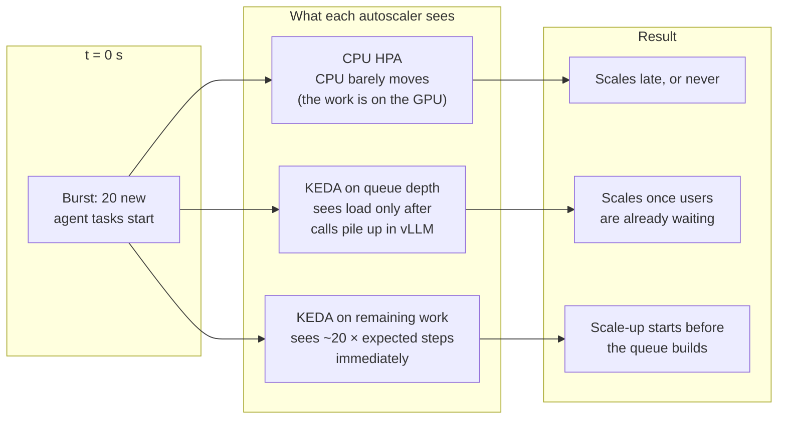

Cold start is real: a new vLLM pod needs time to load the model and warm up. That is exactly why a **leading** signal matters, and why the simulator models cold start explicitly.

---

## Scale-down and failure

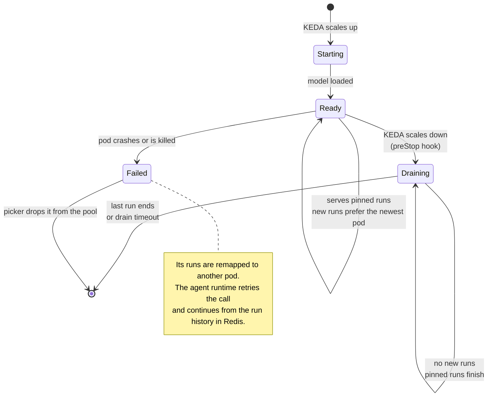

| Event | Goal | Measured as |
|---|---|---|
| Scale-down | **0 interrupted runs** | Runs that lost a call while their pod drained |
| Pod killed mid-run | Runs continue, nothing lost | Completion rate and the extra time recovery costs |

---

## The chat app on top

The infrastructure has a real client: a chat web app where one message becomes one agent run. The model first picks one of three scenarios (or out of scope), then sees only that scenario's tools, so a small model never chooses among all nine tools at once.

| Scenario | Example question | Tools |
|---|---|---|
| **CSV analysis** | "Which region had the highest average sales in Q3?" | `csv_summary`, `group_by`, `compare`, `calculator` |
| **Contracts** | "What changed in the termination clause between these two versions?" | `read_document`, `extract_clauses`, `diff_clauses` (documents read in parallel) |
| **Customer support** | "Order 1042 arrived damaged, what can the customer do?" | `get_order`, `get_policy`, `draft_reply` |
| Out of scope | "Write me a poem" | None: a fixed polite reply |

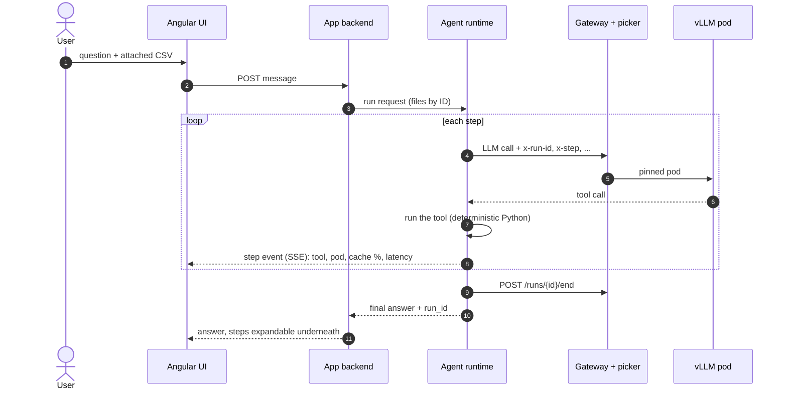

Files never enter the model's context: tools take them by ID and return compact results. History is capped by a token budget and dropped in blocks, so the prompt prefix stays stable across turns and keeps hitting the cache.

---

## The experiments, as designed

This section describes the experiments **as they are meant to run on hardware built for the job**. What they actually ran on, and how the design was scaled down to fit, is in [What it was built and tested on](#what-it-was-built-and-tested-on).

### Ideal setup

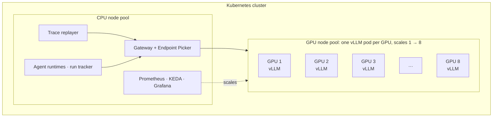

| | Ideal |
|---|---|
| **GPUs** | Up to 8 data-center GPUs (e.g. 80 GB class), one vLLM replica per GPU, no sharing |
| **Model** | A mid-size instruction model with reliable tool calling, long context (32k+), a KV cache that holds many concurrent agent contexts |
| **Scale** | Real pods all the way from 1 to N, so cold start, drain and failover are measured on real hardware at every size |
| **Workload** | Recorded agent traces (own demo tasks + converted AgentProcessBench tasks), replayed with their real tool-time gaps, in steady, bursty and fan-out arrival patterns |
| **Isolation** | Dedicated nodes, nothing else running, identical GPU clocks across runs |

### The three experiments

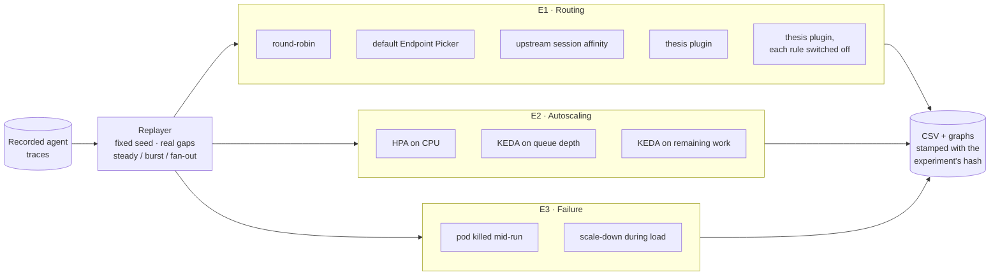

| Experiment | Question | Variants | Metrics |
|---|---|---|---|
| **E1 Routing** | Does keeping a task on its pod make agent tasks faster, and what does each rule contribute? | Round-robin · default picker · upstream session affinity · thesis plugin · ablation (each rule off in turn) | Run completion time (p50, p95), time to first token, prefix-cache hit rate, uncached prompt tokens, pod switches per run |
| **E2 Autoscaling** | Does scaling on remaining work add capacity before users wait, without wasting GPUs? | HPA on CPU · KEDA on queue depth · KEDA on remaining work, on bursty traces | Completion time, throughput, time to capacity, idle pod-minutes, interrupted runs |
| **E3 Failure** | Do tasks survive a pod dying or being scaled away? | Pod killed mid-run · scale-down during a replay | Completion rate, interrupted runs, recovery cost in time |

### Method

- **Every experiment is a YAML file** in [`experiments/`](experiments/); results are stamped with the file's hash, so any number traces back to the exact configuration that produced it. `make experiment NAME=…` regenerates its CSV and graphs from scratch.
- **3 repetitions**, fixed seeds, warm-up runs discarded.
- **Both variant orders**, with a GPU log beside every run: the variant that runs second must not get an advantage from a warmer machine.
- **Feature flags per routing rule**, so ablation is a config change, not a code change.

### Hypotheses (what the design expects, not results)

| | Expectation |
|---|---|
| H1 | Task affinity raises the prefix-cache hit rate and cuts uncached prompt tokens on later steps, most for long tasks. |
| H2 | The overload guard keeps p95 latency under bursts no worse than the default picker, while keeping most of affinity's cache gain. |
| H3 | Scaling on remaining work reaches the needed capacity sooner than queue depth, and CPU-based HPA barely reacts. |
| H4 | Drain gives 0 interrupted runs on scale-down; failover keeps runs completing when a pod dies. |

---

## Status

Planned in 7 phases, each closed by a gate check and a git tag. Phases 0–2 are on `master`; Phase 3 is on `feature/phase-3`.

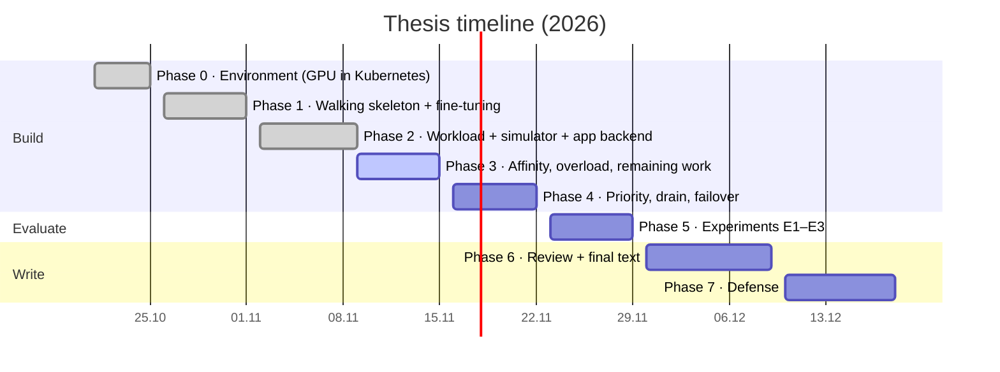

| Phase | | What it delivers |
|---|---|---|
| **0 · Environment** | ✅ Gate 0 | GPU inside Kubernetes under WSL2, two vLLM pods sharing one GPU, prefix caching visible |
| **1 · Walking skeleton** | ✅ Gate 1 | `make up` from zero, Prometheus + Grafana, gateway + Endpoint Picker, agent runtime with Redis history, Angular step view, `make smoke` end to end; LoRA fine-tune of the small model for tool calling |
| **2 · Workload + simulator** | ✅ Gate 2 | All three demo scenarios, call recorder, trace format + replayer, AgentProcessBench converter, first baseline, per-step badges in the UI, calibrated and validated simulator, app backend on SQLite |
| **3 · Affinity, overload, remaining work** | 🔄 in progress | ✅ P3.1 picker built from source · ✅ P3.2 plugin skeleton + feature flags · ✅ P3.3 task affinity · ✅ P3.4 pod removed → runs remapped · ⏳ overload guard · parallel calls · burst replay · run tracker · KEDA · baselines · cluster panel · chats API · chat UI |
| **4 · Priority, drain, failover** | ⏳ | Progress priority, warm-up routing, drain, failover, real 1↔2 validation, demo buttons, scenario suite. **Feature freeze 22.11.2026** |
| **5 · Experiments** | ⏳ | E1, E2, E3 with repetitions; demo rehearsal |
| **6–7 · Text and defense** | ⏳ | Thesis text, mentor review, defense by 18.12.2026 |

---

## Results so far

All numbers below are measured on the laptop described at the end, with the scaled-down setup. Each comes from a hash-stamped experiment file and is logged in [`experiments/log.md`](experiments/log.md), green or red (Phase 3 entries are on the `feature/phase-3` branch until it is merged).

### A small model learned to call tools (Phase 1–2)

A 0.6B model picks the right tool but gets arguments wrong. A LoRA adapter trained on tool-call trajectories generated from the deterministic tools fixed that:

| | Plain Qwen3-0.6B-GPTQ-Int8 | + LoRA adapter |
|---|---|---|
| Held-out questions | 33 / 98 | **167 / 168** (after retraining on all three scenarios, both tool-choice modes) |
| Demo go/no-go (10 real runs) | 4 / 10 | **10 / 10** |

### Baseline: round-robin vs the default picker (Gate 2)

35 replayed agent runs on 2 real pods, 309 calls per variant, 0 failed in both.

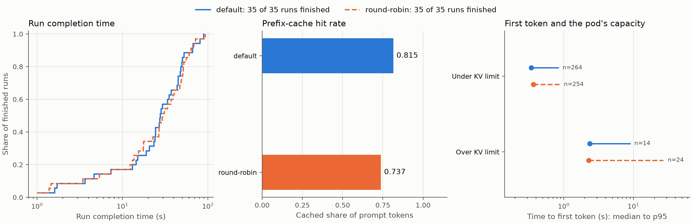

- The default picker's prefix scorer keeps more of each prompt cached: **0.815 vs 0.737** hit rate.
- It finished the runs **6.6% faster** in total over both variant orders (and only 2.9% in one order alone), which is why every real-pod comparison now runs in both orders.
- Calls over a pod's KV-cache limit are where the time goes: their first token takes seconds, not milliseconds.

### The simulator matches real pods on medians (Gate 2)

The same replay on 1 and 2 real pods, then on 1 and 2 calibrated simulated pods.

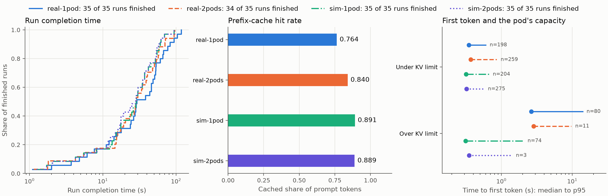

| | 1 pod | 2 pods |
|---|---|---|
| Call duration p50, error | 14% | 1% |
| Run completion p50, error | 2.5% | 1% |
| p95 tails | 18–91% optimistic | 18–63% optimistic |

Medians are within 15%. Tails are optimistic: on a real pod, calls that don't fit the KV cache wait for free blocks, which the simulator doesn't model. **Simulated p95 numbers are therefore always labelled optimistic and shown next to real-pod numbers.**

### Task affinity (Phase 3, P3.3)

35 runs on 2 real pods, default picker vs the plugin's affinity rule.

| | Default picker | Task affinity |
|---|---|---|
| Later steps moved to another pod | 44 of 243 | **0 of 243** |
| Prompt tokens left uncached (calls under the KV limit) | 91,505 | **64,698 (−29%)** |
| Overall prefix-cache hit rate | 0.821 | 0.807 |

The pins hold, and where the default picker moved a run, affinity kept its cache: higher hit rate in 12 of those 15 runs. The overall rate did **not** go up: two long runs were pinned to the same pod at once, together over its KV capacity, and evicted each other. Affinity alone has no answer to cache pressure; that is the overload guard's job (next).

### A pod disappears (Phase 3, P3.4)

On simulated pods, the pod holding the most live runs was deleted mid-replay.

| | Calls | Failed |
|---|---|---|
| Finished before the delete | 23 | 0 |
| Running on the pod at the delete (drained) | 2 | 0 |
| Sent after the pod left the pool | 126 | **0** |

Both affected runs were remapped once to the surviving pod and stayed there; 20 of 20 runs sent their end-of-run signal to the picker.

---

## Running it

> Needs an NVIDIA GPU. The scripts target Windows 11 + WSL2 (Ubuntu 24.04), the machine this was built on; a native Ubuntu 24.04 host with the NVIDIA driver should only need the WSL-specific steps skipped. Every tool version is pinned in [`versions.md`](versions.md).

```bash
infra/bootstrap.sh      # install the pinned dev tools
make up                 # build the cluster from zero: k3s, GPU, vLLM, gateway, monitoring, agent, app
make smoke              # one task through every layer, exits 0 on success
```

| Command | What it does |
|---|---|
| `make up PROFILE=sim` | The cluster on simulated vLLM pods (no model, agent or app; for replays) |
| `make down` | Tear the cluster down (app users and chats are kept) |
| `make test` | All unit tests, Go and Python |
| `make lint` | All pre-commit hooks |
| `make ui PROFILE=…` | Install and serve the Angular app for a profile |
| `make grafana` | Port-forward Grafana to `localhost:3000`: queues, KV usage, cache hit rate per pod |
| `make record` | Record real agent runs into a trace |
| `make replay TRACE=… PATTERN=…` | Replay recorded tasks (steady, burst, steady-fan-out) |
| `make experiment NAME=…` | Run an experiment file and regenerate its CSV and graph |
| `make experiment-compare CSVS=…` | Compare variants run by run |
| `make calibrate` | Measure real pods to calibrate the simulator |
| `make reset-app` | Wipe app users, chats and files |

Switching between the real GPU, the simulator and the demo model is one profile in [`config/`](config/): `real`, `sim`, `demo`.

---

## Repository layout

```
config/        profiles (real, sim, demo): every tunable, nothing hardcoded
schemas/       versioned JSON schemas: headers, trace, run request, run events, run calls
infra/         cluster setup scripts, Helm charts and values, manifests
gateway/       Go Endpoint Picker plugin (on feature/phase-3)
agent/         Python agent runtime, tools, run tracker
app/           Python app backend + SQLite: users, sessions, chats, attachments
loadgen/       trace recorder, replayer, converters, experiment runner, graphs
sim/           simulator calibration tables and validation
training/      LoRA fine-tuning of the small model (its own uv project)
ui/            Angular app: login, chats, step view, cluster panel
experiments/   experiment files, results (CSV, JSONL), graphs, log.md
docs/          design system, task cards, thesis outline
```

The design decisions (D1–D14), every task with its done-when check, and the fallback plan are in [`PLAN.md`](PLAN.md).

---

## What it was built and tested on

Everything above runs on **one gaming laptop**. The design was scaled down to fit it, and every shortcut is a stated limitation rather than a hidden one.

| | Value |
|---|---|
| Laptop | ASUS ROG Strix G15 (2021) |
| CPU | AMD Ryzen 7 |
| GPU | NVIDIA RTX 3050 Laptop, **4 GB** |
| RAM | 16 GB (10 GB given to WSL2, plus 8 GB swap) |
| OS | Windows 11 Pro + WSL2, Ubuntu 24.04.5 LTS |
| Kubernetes | k3s v1.36.5, single node, NVIDIA device plugin with time-slicing (2 GPU slots) |
| Serving | vLLM v0.31.0, two pods sharing the one GPU |
| Gateway | Gateway API v1.6.3, Inference Extension v1.6.2, llm-d-router v0.11.0 |
| Simulator | llm-d-inference-sim v1.0.0 |
| Monitoring | kube-prometheus-stack 92.3.0 (Prometheus v3.15.0, Grafana 13.2.3) |
| Cost | €0 |

**How the ideal design maps onto it:**

| Ideal | On the laptop | Consequence |
|---|---|---|
| One GPU per vLLM pod | Two pods share one 4 GB GPU | Real-pod scaling only 1 ↔ 2; pods slow each other down by an amount that varied between nights |
| Mid-size model, long context | **Qwen3-0.6B-GPTQ-Int8** + LoRA adapter for experiments; **Qwen3-1.7B-GPTQ-Int8** (one replica) for the practical demo; Qwen3-4B did not fit | Max context 4,096 tokens, KV cache ~4,400 tokens per pod, so long agent tasks hit the cache limit often |
| Real pods from 1 to N | Simulated pods calibrated from the real GPU (prefill cost, per-token time, cold start), validated against real pods at 1 and 2 | Autoscaling at scale runs on the simulator; its medians match real pods within 15%, its p95 tails are optimistic |
| Dedicated, isolated nodes | A laptop under WSL2 | Speed drifted between nights by about the validation tolerance; laptop use during a run moved results by ~15%. Hence: both variant orders, GPU logs, sleep disabled, the laptop left alone during runs |

---

<sub>Built with a strict workflow: one task per commit, tests first for logic, a done-when check run by hand for every task, and a fresh-eyes review of every diff. The full record, including the failed runs, is in [`experiments/log.md`](experiments/log.md).</sub>
